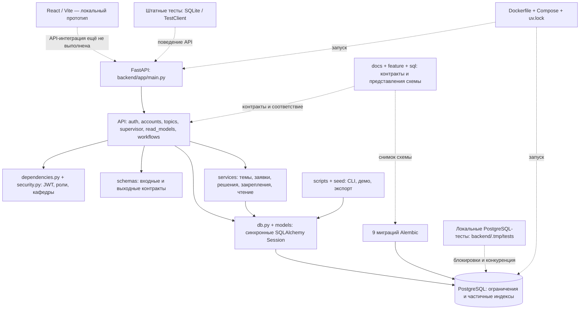

# Этап 1. Компоненты проекта и гигиена репозитория

Дата: 2026-11-11. Проверяемый HEAD: `80d6cd22b378`.
Ветка: `hotfix/backend-workflows`, после интеграции `origin/develop`.

Это исторический снимок этапа 1. По экспертной оценке отчёты перенесены из
`docs/reviews` в `.tmp/reviews`; актуальный статус исправлений и результаты
следующего этапа находятся в [отчёте этапа 2](02-business-methods.md).

Статус: локальный отчёт подготовлен; размещение на Holst не выполнено.
Подключённый сервис досок Doska возвращает MCP Internal error (-32603)
при запросах списка досок и проектов. Соответствие Doska требуемому Holst
не подтверждено. Схема ниже подготовлена для переноса на нужный холст.

## Метод и ограничения

- Проверены Git-состав, локальная рабочая копия, точки входа, конфигурация,
  границы слоёв, тестовая инфраструктура и документация.
- Использованы Repowise MCP `get_overview`, `get_context`, `get_health`,
  затем актуальный локальный CLI: `repowise update --index-only --no-agents
  --no-workspace` и `repowise health --no-workspace --scope production --format table`.
- CLI обновил `last_sync_commit` до проверяемого HEAD. После обновления
  MCP-сессия всё ещё сообщала `indexed_commit=b038097f56c9` и `index_behind=true`.
  Поэтому приведённые ниже оценки взяты из CLI, а не из устаревшего MCP-ответа.
- Индексирование выполнено по коммитам, без `--working-tree`: локальные удаления
  документов и незакоммиченные тесты не считаются содержимым проверяемого коммита.
- Документационные страницы обновлены частично: CLI сообщил о достижении
  cascade budget и оставшихся устаревших страницах. Архитектурные выводы сверены
  с исходниками. Семантический поиск MCP недоступен (`embedder=mock`).
- Тесты, линтеры, сборка и миграции на этом этапе не запускались.
  Это структурное ревью, не подтверждение корректности бизнес-операций.

## Карта для Holst

Сплошные стрелки показывают связи исполняемых компонентов; пунктирные —
контроль, документирование или целевую, пока отсутствующую интеграцию.

Прямая связь API → DB отражает существующие запросы и транзакционные операции
в роутерах; это описание текущего состояния, а не целевой архитектуры.

## Основные компоненты и порядок проверки

В Git 119 файлов. Числа Python-файлов включают `__init__.py`:
API — 7; сервисы — 8; модели — 9; схемы — 8; штатные тесты — 6
(5 тестовых модулей и conftest); версии миграций — 9.

| Приоритет | Компонент | Где смотреть | Что требуется проверить на следующих этапах |
|---|---|---|---|
| 1 | Тема → заявка → закрепление | [application](../../backend/app/services/application.py), [supervisor](../../backend/app/services/supervisor.py), [workflow](../../backend/app/services/workflow.py), [management](../../backend/app/services/management.py) | Транзакции, гонки, лимиты, уникальность, история, rollback; одинаковые правила ручного назначения и одобрения |
| 1 | Идентификация и права | [dependencies](../../backend/app/dependencies.py), [security](../../backend/app/security.py), [auth](../../backend/app/api/auth.py), [accounts](../../backend/app/api/accounts.py) | Четыре роли, активность из БД, границы кафедр, чужие темы, неуспешные входы |
| 1 | Хранение и миграции | [models](../../backend/app/models/), [миграции](../../backend/migrations/versions/), [db](../../backend/app/db.py) | Статусы вместо удаления, частичные индексы, соответствие ORM и миграций, полный цикл на PostgreSQL |
| 2 | Темы и модерация | [topic](../../backend/app/services/topic.py), [topics API](../../backend/app/api/topics.py) | Публикация, происхождение темы, архивирование, запросы на удаление |
| 2 | Контракты и представления | [schemas](../../backend/app/schemas/), [read_models](../../backend/app/services/read_models.py), [API](../../backend/app/api/) | Алиасы маршрутов, response models, пустые поля, побочные эффекты чтения, соответствие контрактам экранов |
| 2 | Проверки и запуск | [тесты](../../backend/tests/), [scripts](../../backend/scripts/), [Dockerfile](../../Dockerfile), [pyproject](../../pyproject.toml) | Воспроизводимость запуска, PostgreSQL-проверки, фиксация версий инструментов, CI |
| 3 | Интерфейс | [App.tsx](../../frontend/src/App.tsx), [package.json](../../frontend/package.json) | Границы компонентов и локальные данные; отсутствие API-интеграции признано в README |
| 3 | Документация и экспорт | [docs](../../docs/), [feature](../../feature/), [SQL-снимок](../../sql/schema.sql) | Актуальность путей и ссылок, происхождение генерируемых документов, согласованность схемы |

Порядок задан последствиями для бизнес-инвариантов, а не только баллом Repowise.

## Оценка Repowise

Актуальный CLI-снимок: production health **9.1/10**, hotspot health **8.49/10**;
проанализированы 64 из 65 файлов данного scope. Один файл не поддержан анализатором.
В production scope показаны 50 открытых findings; это маркеры анализа, не 50
подтверждённых дефектов. Шкала health — оценка кода и истории, не вероятность ошибки.

| Файл | Health | Максимальная CCN | Вывод для плана ревью |
|---|---:|---:|---|
| [services/supervisor.py](../../backend/app/services/supervisor.py) | 6.50 | 9 | Сначала проверить решения по заявкам и изменение прогресса |
| [services/topic.py](../../backend/app/services/topic.py) | 7.02 | 18 | Проверить ветвления жизненного цикла темы |
| [App.tsx](../../frontend/src/App.tsx) | 7.50 | 24 | Кандидат на декомпозицию после согласования предметных контрактов |
| [scripts/dump_docs.py](../../backend/scripts/dump_docs.py) | 7.64 | 23 | Генератор документации проверить отдельно от рабочего процесса |
| [api/auth.py](../../backend/app/api/auth.py) | 8.75 | 15 | Роутер содержит алгоритм входа и управление транзакцией |
| [services/workflow.py](../../backend/app/services/workflow.py) | 8.89 | 13 | Проверить блокировки и повторное чтение лимита под конкуренцией |

Repowise рекомендует декомпозицию App, create_application и decide_application.
Рекомендации пока не применялись: этап 1 определяет область проверки.
Маркеры `untested_*` нельзя трактовать как доказательство отсутствия тестов:
штатные тесты существуют, а измеренное покрытие в MCP отсутствует. Показатель
performance coverage в CLI означает охват статического анализатора, не test coverage.

## Находки по гигиене

| ID | Важность | Наблюдение и доказательство | Требуемое действие |
|---|---|---|---|
| H01 | Высокая для достоверности ревью | [.mcp.json](../../.mcp.json) указывает `F:/SchoolX/DiplomNavigator`, текущий корень — `F:/1. SchoolX/DiplomNavigator`. Другой MCP возвращает отсутствие индекса. Рабочая MCP-сессия после CLI-update продолжает возвращать старые данные | Согласовать пути конфигураций и переподключить нужный MCP; проверять indexed_commit и live_head перед использованием оценок |
| H02 | Высокая для воспроизводимости проверки | [pyproject.toml](../../pyproject.toml) включает только `backend/tests`; там [SQLite-фикстура](../../backend/tests/conftest.py). На момент этапа 1 PostgreSQL-проверки находились в `backend/.tmp/tests` (теперь [integration](../../backend/tests/integration/)) | Проверить и перенести релевантные проверки в штатный набор; выделить безопасный отдельный PostgreSQL-запуск |
| H03 | Средняя, локальное состояние | [README](../../README.md) ссылается на [USER.md](../../USER.md), [TRY1.md](../../TRY1.md), [TASK.md](../../TASK.md), а `git status` показывает их удаления и копии в [.tmp](../../.tmp/) | Согласовать назначение локального переноса и ссылки до PR; в HEAD документы ещё присутствуют, это не доказанный дефект develop |
| H04 | Средняя | [AGENTS.md](../../AGENTS.md) описывает async SQLAlchemy и `app.main:app`, тогда как [db.py](../../backend/app/db.py) использует create_engine/Session и [Dockerfile](../../Dockerfile) запускает `backend.app.main:app` | Актуализировать локальные инструкции по реальным путям и синхронной сессии; mypy в pyproject не настроен |
| H05 | Средняя | [.dockerignore](../../.dockerignore) не исключает `.tmp`; [Dockerfile](../../Dockerfile) использует `COPY . .`, затем копирует весь backend в runtime | Исключить временные материалы и локальные аудит-тесты из build context и runtime без удаления пользовательских файлов |
| H06 | Средняя | В рабочей копии нет `.github/workflows`; в [pyproject.toml](../../pyproject.toml) настроен pytest/ruff, но нет конфигурации mypy | Согласовать минимальные автоматические проверки PR; не считать обязательный mypy уже настроенным |
| H07 | Низкая | [Dockerfile](../../Dockerfile) получает uv через `ghcr.io/astral-sh/uv:latest` при зафиксированном uv.lock | Зафиксировать версию инструмента сборки для воспроизводимости |
| H08 | Низкая, локальное состояние | В корневых app/migrations/scripts/tests остались только кэши: соответственно 50/9/9/6 файлов, Python-исходников нет; в Git они отсутствуют | Не считать их второй архитектурой backend; очистку выполнять отдельно после согласования необходимости |
| H09 | Средняя для ревью-документов | [.gitignore](../../.gitignore) исключает `/docs/*` с перечнем исключений | Для этого отчёта добавлено исключение `/docs/reviews/`, чтобы артефакт можно было включить в последующий PR |

Положительные признаки: разделение API/services/models/schemas уже существует;
зависимости имеют lock-файлы; есть шаблон окружения; миграции образуют по исходникам
одну цепочку до `c7e2f3a4b5c6`; секретный `.env`, node_modules и Python-кэши
не обнаружены среди отслеживаемых файлов. Это не полный поиск утечек секретов.

## Важный вход для следующего этапа

В [локальном историческом отчёте](00-postgresql-audit-history.md) для `8365508`
описано: «67 passed, 1 failed», одобрение после изменения лимита даёт нагрузку 2
при лимите 1. Есть [сценарий воспроизведения](../../backend/tests/integration/test_postgresql_concurrency.py)
`test_approval_rechecks_limit_changed_while_waiting_for_lock`.
Это историческое свидетельство, а не результат запуска в текущем ревью.
Его проверка должна предшествовать косметическому упрощению workflow.

## Выполненные изменения и экспертная оценка

- Интегрирован origin/develop без конфликтов; исходные локальные удаления и
  незакоммиченные материалы сохранены.
- Обновлён локальный индекс Repowise; инструмент также обновил игнорируемые
  настройки VS Code и Copilot. Прикладной код и корневой MCP-конфиг не менялись.
- Добавлены этот отчёт и исключение для каталога отчётов в Git.
- Публикация на Holst остаётся открытой до доступности нужного сервиса/адреса.
- Этапы 2 и 3 не начаты; PR, коммит отчёта и push не выполнялись.

Для экспертной оценки: верен ли приоритет транзакций/прав перед декомпозицией UI;
достаточны ли границы компонентов; нужно ли включить локальные PostgreSQL-проверки
в следующий этап? После оценки уточняется область инвентаризации бизнес-методов.
