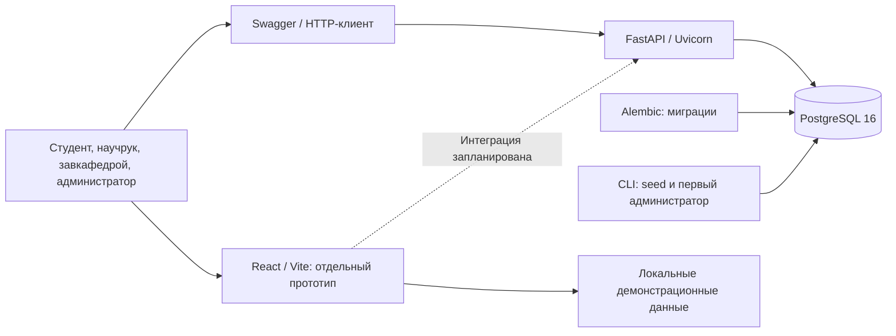
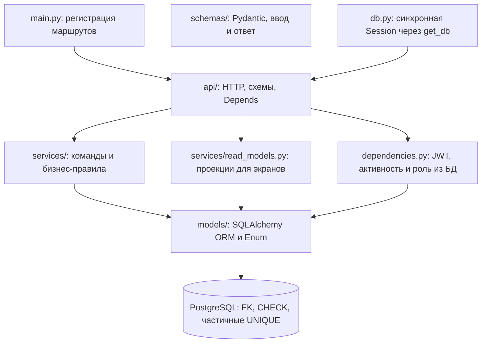

# Архитектура backend

Проверено 18.11.2026 по коду `95ca12e`. Это архитектура текущего серверного ядра;
согласованные изменения и вопросы ревьюеру приведены в [материалах ревью](backend-review-appts.md).

## Контекст и развёртывание



- Backend — одно приложение, организованное по слоям. Выделенных микросервисов нет.
- Docker Compose запускает приложение и PostgreSQL. Миграции и seed запускаются
  отдельно по [README](../README.md); автоматическое применение при старте не заявлено.
- Worker, очередь, хранилище файлов, экспорт Excel/PDF, SMTP/push и автоматический
  backup в текущем приложении не реализованы.
- `/health` проверяет живость процесса и возвращает окружение; запрос к БД не выполняет.
  Это не проверка готовности базы.

## Слои приложения



| Ответственность | Основные источники |
|---|---|
| Вход, failed-attempt counters, cooldown | [authentication.py](../backend/app/services/authentication.py), [security.py](../backend/app/security.py) |
| Текущий пользователь и роли | [dependencies.py](../backend/app/dependencies.py) |
| Аккаунты и кафедра профиля | [account_management.py](../backend/app/services/account_management.py) |
| Создание и модерация тем | [topic.py](../backend/app/services/topic.py), [topic_deletion.py](../backend/app/services/topic_deletion.py) |
| Подача и истечение заявок | [application.py](../backend/app/services/application.py) |
| Решение по заявке | [supervisor.py](../backend/app/services/supervisor.py) |
| Ручное назначение и лимиты | [management.py](../backend/app/services/management.py) |
| Общие блокировки и ограничения | [workflow.py](../backend/app/services/workflow.py) |
| Создание закрепления и начальной истории | [assignment_records.py](../backend/app/services/assignment_records.py) |
| Прогресс, история, отзыв допуска | [progress.py](../backend/app/services/progress.py) |
| Дашборды и выдача данных | [read_models.py](../backend/app/services/read_models.py) |

Маршруты с блокирующими операциями БД объявлены как `def` и используют синхронную
`Session`. Роли: `admin`, `zavkaf`, `nauchruk`, `student`. `Teacher` — профиль
руководителя в модели данных, отдельной API-роли `teacher` нет.
JWT определяет пользователя; текущая роль и `is_active` проверяются по БД.

## Одобрение заявки: ключевая транзакция

```mermaid
sequenceDiagram
    actor Actor as Научрук / завкаф / admin
    participant Route as API
    participant Service as Сервис решения
    participant DB as PostgreSQL
    Actor->>Route: PATCH /reservations/{id}/approve
    Route->>DB: Проверить JWT, пользователя, роль
    Route->>Service: decide_application
    Note over Service,DB: До решения возможна отдельная фиксация истекших заявок
    Service->>DB: Заблокировать Student, Application, Topic
    Service->>Service: Проверить pending и область доступа
    Service->>DB: Заблокировать и перечитать Teacher
    Service->>DB: Посчитать active Assignment и проверить лимит
    Service->>DB: Проверить занятость студента и темы
    alt Проверки пройдены
        Service->>DB: approved Application и active Assignment
        Service->>DB: Отозвать остальные pending студента
        Service->>DB: Истории заявки и прогресса, уведомление
        Service->>DB: COMMIT
        Service-->>Actor: 200, результат решения
    else Нарушение области или бизнес-условий
        Service-->>Actor: 403 / 404 / 409
    else Конфликт целостности при commit
        DB-->>Service: IntegrityError
        Service->>DB: ROLLBACK
        Service-->>Actor: 409
    end
```

Нагрузка вычисляется как количество закреплений руководителя со `status=active`.
Отдельного изменяемого счётчика `current_load` в БД нет. При `completed` работа
перестаёт входить в нагрузку. Будущая отмена и передача должны использовать те же
блокировки и правила подсчёта.

В одной транзакции решения сохраняются заявка, закрепление, отзыв других резервов,
их история и уведомление. Предварительная очистка просрочки может коммититься
отдельно и сохраниться даже при последующем отказе в решении.
Это показано в диаграмме явно: единой транзакции на весь HTTP-запрос здесь нет.

## Модель данных и границы её чтения

Полная [ER-диаграмма](er.md) содержит 15 таблиц; [SQL-снимок](../sql/schema.sql)
сверен с ORM, [история миграций](migration-history.md) — с Alembic.
Актуальная вершина: `d8f3a4b5c6d7`.

Три независимых понятия: `Topic` — предложение, `Application` — намерение
студента, `Assignment` — факт закрепления. URL `bookings` и `reservations`
являются представлениями/алиасами заявок и не вводят новую сущность.

ER показывает физические внешние ключи, но не все UNIQUE/CHECK и правила доступа.
Например, связь профиля с пользователем дополнительно ограничена уникальностью
`user_id`. Наличие `attachments` в ER означает существование таблицы, но не
готовность загрузки файлов. Наличие `notifications.is_read` не означает готовность
операции отметки прочтения.

Критические частичные индексы:

| Ограничение | Условие |
|---|---|
| Одно активное закрепление студента | `assignments.student_id`, `status = 'active'` |
| Одно неотменённое закрепление темы | `assignments.topic_id`, `status <> 'cancelled'`; включает завершённые |
| Одна активная заявка на тему | `applications.topic_id`, `status IN ('pending', 'approved')` |
| Одна активная заявка пары студент–тема | Пара ID, `status IN ('pending', 'approved')` |

Индексы не защищают сами по себе согласованность кафедр после административного
перевода и не заменяют таблицу переходов статусов. Подтверждённые пробелы и
предлагаемые критерии исправления вынесены в [ревью](backend-review-appts.md).

## Проверки и воспроизводимость

[Протокол тестирования](test-summary.md): основной SQLite-набор, изолированный
PostgreSQL с миграциями и конкурентными сценариями. [CI](../.github/workflows/backend-checks.yml)
настроен для pull request и push в `review/**`, Python 3.12. Диапазон проекта
3.12–3.13 не означает, что CI сейчас проверяет обе версии.

Генерируемые ER, API и историю обновляют командой
`uv run python -m backend.scripts.export_demo_docs`; SQL —
`uv run python -m backend.scripts.dump_ddl`. Схему рабочей БД меняют только Alembic.

## Согласованные изменения первой итерации

Существующая архитектура выше описывает кодовую базу b330bd0. Целевые правила
Q1–Q12 и критерии их реализации: [обзор](backend-review-appts.md).

- Перевод кафедры и создание связей должны использовать общие блокировки,
  согласованные с подачей, назначением, модерацией и созданием предложений.
- Истечение целевой заявки проверяется по свежему времени после блокировок.
  Сохранение expired и событий при отказе — отдельный результат команды.
- Статус Topic при истечении сохраняется; обработка повторяема без дубликатов.
- Штатная защита требует допуска, 100%, active и nauchruk + ownership.
  Повышение до zavkaf временно лишает этого права и для собственных работ.
- Аудит фактического перевода и назначения льготного срока должен сохраняться
  атомарно с соответствующим изменением. Назначение срока не меняет статус.
- Новые pending обязаны иметь expires_at; approved может сохранять NULL.
  Условный CHECK и заполнение старых данных планируются отдельной Alembic-миграцией.

Эти изменения ещё не реализованы. Протокол проверок не является подтверждением
их готовности, а диаграммы текущей транзакции не заменяют проект её изменения.
