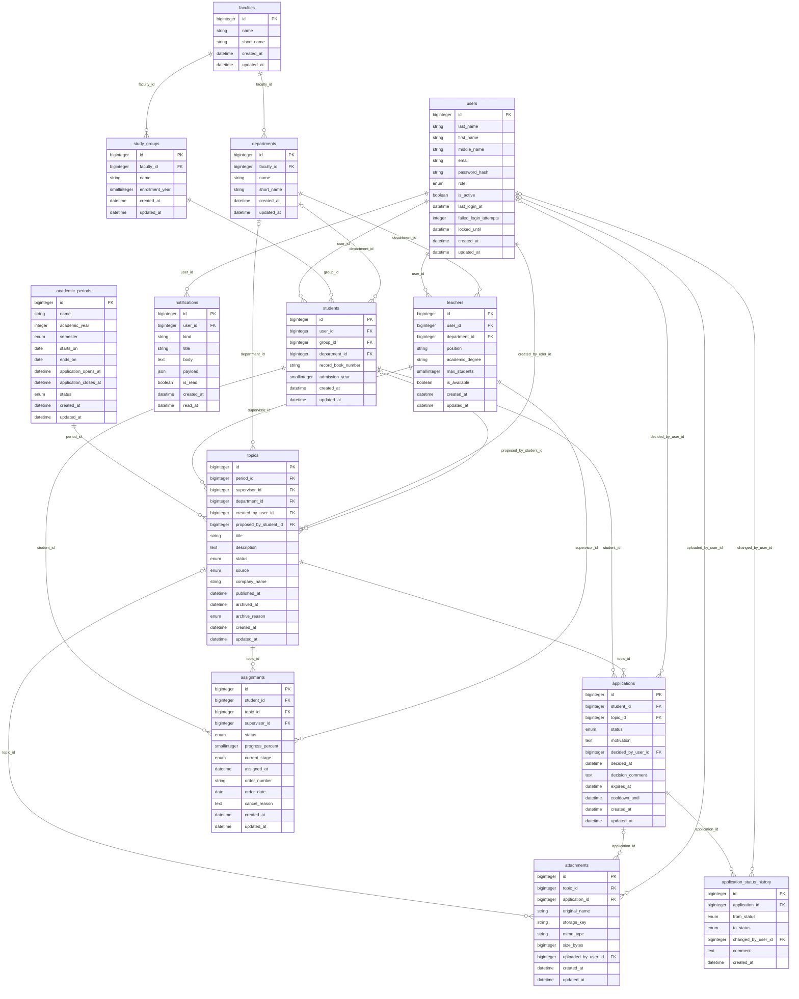

# ER-диаграмма

Сгенерировано: `uv run python -m backend.scripts.export_demo_docs`.

Частичные уникальные индексы обеспечивают одно активное закрепление
на студента, одну активную заявку на тему и одно неотменённое закрепление на тему.
