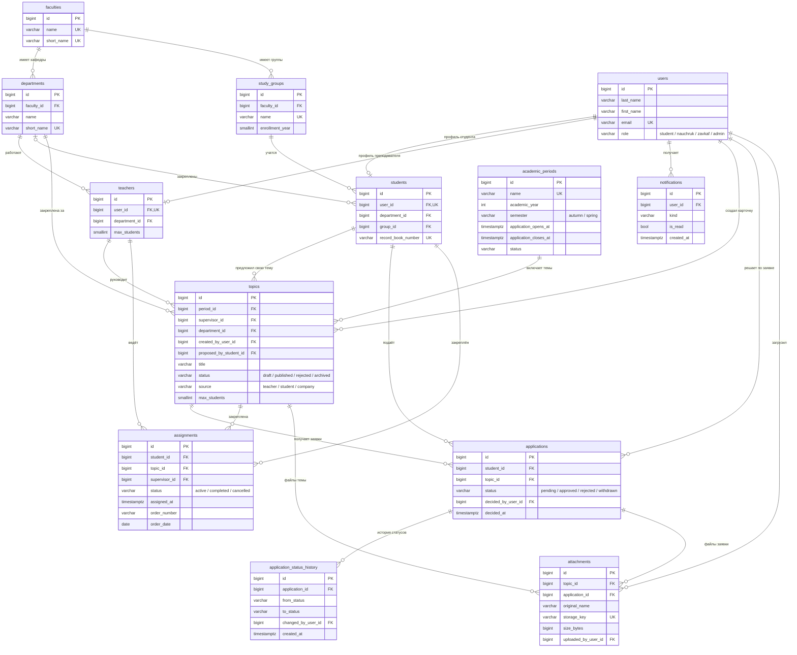

# Схема данных DiplomNavigator v0.1

Диаграмма отражает только ключевые поля (PK/FK). Полный перечень колонок —
в [словаре данных](data-dictionary.md), он генерируется из моделей и всегда
актуален.

## Как читать схему

1. **`users` — это только учётные записи.** Кто человек в предметной области,
   решают `students` и `teachers`, которые ссылаются на `users` один-к-одному.
   Так один аккаунт может быть и научруком, и методистом, и внешним
   пользователем, а авторизация не зависит от роли.
2. **`academic_periods` — рамка всего.** Тема всегда принадлежит периоду.
   Без этого «текущий семестр» протекает в код и в отчёты.
3. **`topics` — предложение, `applications` — намерение, `assignments` — факт.**
   Три разные сущности с разным жизненным циклом. Нельзя выкинуть
   `assignments` и считать «закреплён» статусом заявки: заявку можно отозвать
   и подать заново, а закрепление живёт отдельно и имеет номер приказа.
4. **`application_status_history`** хранит путь, а не последний шаг: на разборе
   нужен ответ «кто отклонил и когда», а не только текущий статус.
5. **`attachments`** — один владелец на файл, проверяется
   `num_nonnulls(topic_id, application_id) = 1`. Полиморфную пару
   `(owner_type, owner_id)` сознательно не взяли: с ней нельзя поставить FK.

## Правила, зашитые в БД, а не в код

| Правило | Где живёт |
| --- | --- |
| У студента не больше одного активного закрепления | частичный UNIQUE `uq_assignments_student_id_active` |
| Одна активная заявка на тему от одного студента | частичный UNIQUE `uq_applications_student_id_topic_id_active` |
| Отмена закрепления требует причины | CHECK `ck_assignments_cancelled_requires_reason` |
| Период не может кончиться раньше начала | CHECK `ck_academic_periods_dates_order` |
| Окно подачи заявок закрывается позже, чем открывается | CHECK `ck_academic_periods_application_window` |
| Email уникален без учёта регистра | `CREATE UNIQUE INDEX uq_users_email_lower ON users (lower(email))` |
| У файла ровно один владелец | CHECK `ck_attachments_exactly_one_owner` |

## Чего в схеме сознательно нет

Это не забытое, а отложенное — чтобы не тащить в MVP лишнее:

- **теги и области знаний** (`tags`, `topic_tags`) — нужны для поиска, но
  набор тегов ещё никто не сформулировал;
- **комментарии/обсуждение темы** (`comments`) — на MVP хватает
  `applications.decision_comment`;
- **этапы работы** (главы, проверки, рецензии) — это отдельный домен, если
  продукт пойдёт дальше выбора темы;
- **аудит-лог** изменений всех сущностей — истории статусов заявок достаточно
  для первого семестра;
- **мягкое удаление** (`deleted_at`) — пока неясно, нужно ли восстанавливать
  удалённые темы; сейчас удаление ограничено внешними ключами.
