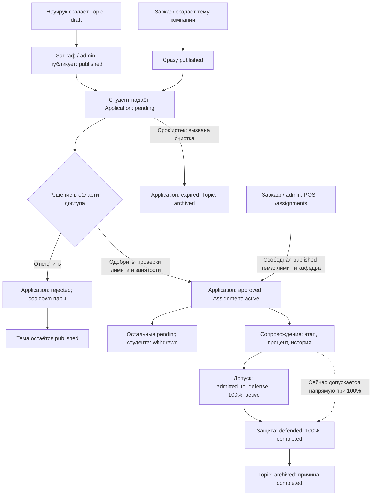
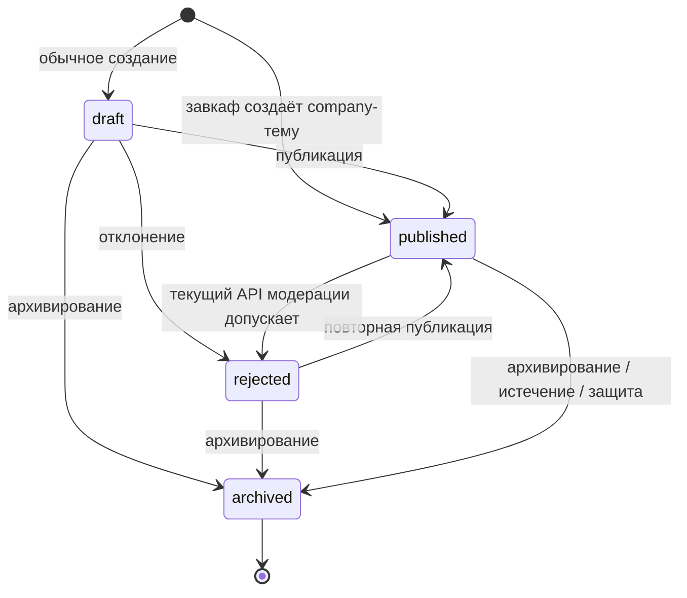
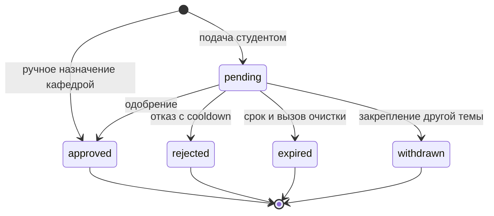
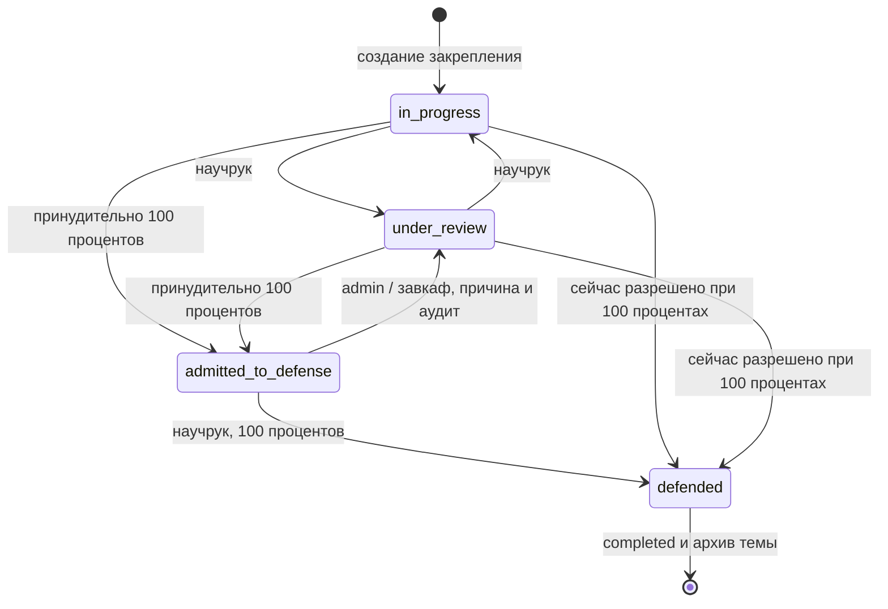

# Логика процесса и состояния

Снимок реализации `95ca12e`, проверка 18.11.2026.
Диаграммы описывают существующее поведение. Спорные правила отмечены отдельно;
их наличие в коде не означает согласование техлидом.

## Сквозной сценарий

Ручное назначение создаёт отдельные `Application(approved)` и `Assignment(active)`.
Закрытый период не блокирует это административное действие. Нельзя забрать тему
с чужой pending-заявкой, обойти лимит или второе активное закрепление студента.

## Тема

Возврат в `draft` и модерация уже архивной темы запрещены. Научрук отправляет
запрос на архивирование; завкаф/admin принимает решение. Этот путь запрещает
архивирование при активном закреплении. Прямой `PATCH /topics/{id}/status`
сейчас такую проверку не выполняет — см. R02 в [реестре решений](backend-review-appts.md).
Архивирование не является физическим удалением.

## Заявка

- До закрепления студент может иметь pending-заявки на разные темы.
- На одну тему допускается одна активная заявка (`pending` или `approved`).
- После закрепления остальные pending студента автоматически отзываются.
- Самостоятельного отзыва заявки студентом через API нет.
- Срок решения и cooldown после отказа используют одну настройку
  `APPLICATION_DECISION_TIMEOUT_MINUTES`. В шаблоне и fallback кода — 2 минуты;
  для демонстрации README рекомендует 20160 минут (14 дней).
- Истечение выполняется при отдельных запросах/командах, включая некоторые GET.
  Фонового расписания нет. Существующая функция архивирует тему и не создаёт
  уведомление об истечении. Старое предложение «вернуть тему в каталог и уведомить»
  не соответствует этому коду.

## Закрепление и прогресс

`Assignment.status` (`active`, `completed`, `cancelled`) и `current_stage` —
разные поля. Ниже показаны этапы; отмена закрепления ещё не имеет рабочего API.

Повторное обновление внутри одного незавершённого этапа допускается. Обычным
PATCH прогресса нельзя вернуть допущенную работу на предыдущий этап.
Отзыв допуска — отдельный `POST /assignments/{id}/revoke-admission`; сохраняет
100%, автора и причину, переводит в `under_review`. После `defended` обновление
прогресса и отзыв допуска запрещены.

Переход непосредственно к `defended` из первых этапов разрешён текущим кодом
и проверяется существующими тестами. Владелец согласовал обязательный допуск;
код и тестовые ожидания ещё требуют изменения — R05 в [ревью](backend-review-appts.md).

## Целевое поведение, согласованное 18.11.2026

Следующие правила приняты владельцем проекта, но ещё не реализованы. Диаграммы
выше показывают существующий код; они не являются диаграммами будущего релиза.

1. Подача: только open и opens_at ≤ now < closes_at, проверка после блокировок.
   Ручное назначение обходит только период, сохраняя права, кафедру, тему и лимит.
2. Истечение: pending → expired, история и уведомление студенту; Topic не меняет
   статус. Освобождение резерва не публикует rejected/archived заново.
   Повтор не дублирует события; approved не истекает.
3. Решение: финальная проверка актуального expires_at и времени после всех
   необходимых блокировок. При now ≥ expires_at — 409 без закрепления, но
   с сохранёнными expired, историей и уведомлением. Commit может завершиться
   позже срока, если финальная проверка была выполнена до него.
4. Модерация: archived/rejected запрещены при active Assignment или pending
   через все пути, без изменений целевых данных. Прошедший срок не заменяет
   обработку pending механизмом истечения. Автоматического отзыва здесь нет.
5. Защита: active + admitted_to_defense + 100%; атомарные completed, архив темы,
   история и уведомление. После отзыва допуска нужен повторный допуск.
6. Полномочия защиты: одновременно nauchruk и ownership. Повышение до zavkaf
   временно лишает права на защиту собственных работ. Обход admin-PATCH запрещён.
7. Перевод: запрет при pending/active и собственных темах научрука в
   draft/published/rejected; также при proposed_by_student_id у таких тем.
   Archived не блокирует по авторству, но остальные запреты сохраняются.
8. Простой перевод меняет только кафедру профиля. Та же кафедра — 200 без
   изменений после авторизации. История сохраняет прежнюю принадлежность.
   Аудит фактической смены: исполнитель, время, старая и новая кафедры.
9. Перевод и создание связей используют общий протокол блокировок. Причины
   отказа стабильны: pending_applications, active_assignments, unclosed_topics.
10. Перенос связанных объектов и административный обход допуска отложены
    в отдельные задачи; обычные endpoints не выполняют их неявно.
11. Старые подходящие pending без срока после инвентаризации получают отдельный
    льготный срок T0 + 14 дней. Уже заданные сроки не меняются; назначение
    аудируется без смены статуса и не продлевается повторным выполнением.
12. Новые pending получают срок на сервере; БД защищена условным CHECK
    status <> 'pending' OR expires_at IS NOT NULL. Approved с NULL допустим.

Полные вопросы к ревьюеру, миграция Q12 и конкурентная приёмка:
[обзор backend](backend-review-appts.md).
