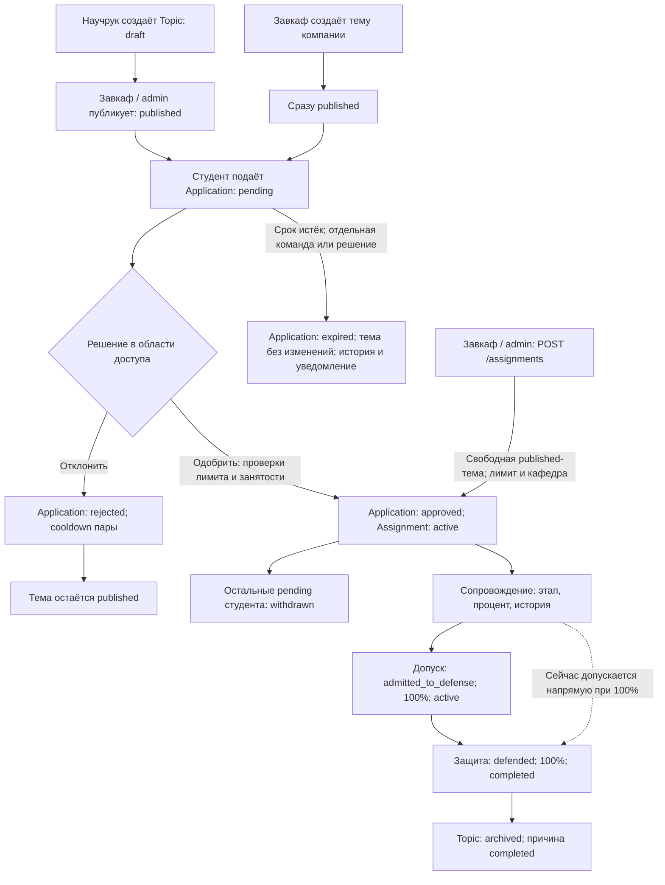
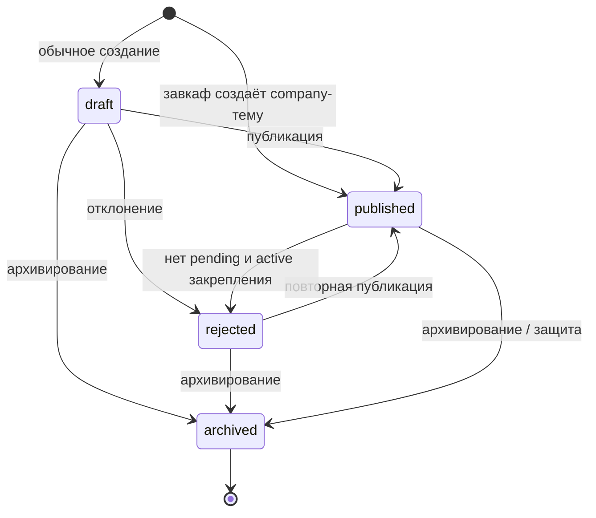
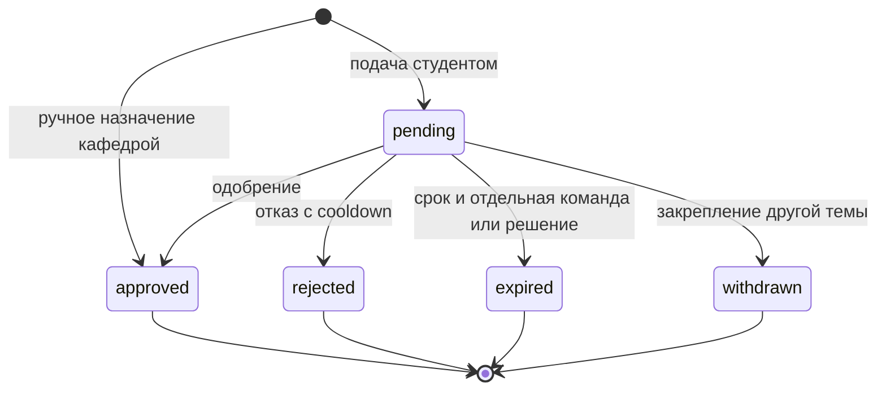
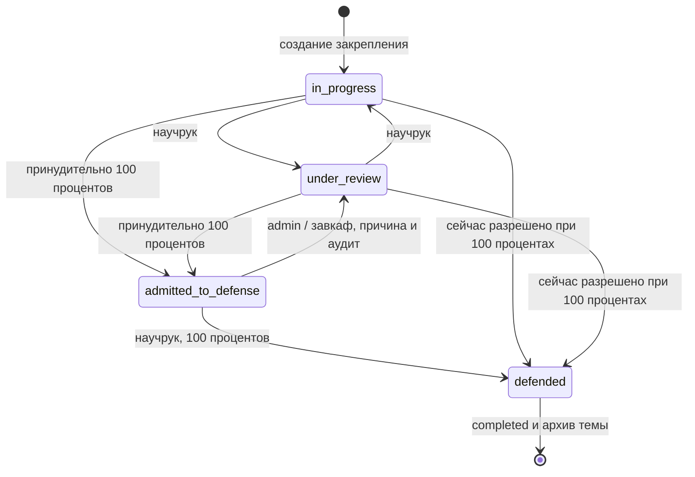

# Логика процесса и состояния

Диаграммы отражают поведение после реализации Q1–Q4, Q6–Q8 и Q10.
Подробности — в контрактах [цикла заявки](application-transactions.md)
и [модерации и перевода](topic-department-contract.md).

## Сквозной сценарий

Ручное назначение создаёт отдельные `Application(approved)` и `Assignment(active)`.
Закрытый период не блокирует это административное действие. Нельзя забрать тему
с чужой pending-заявкой, обойти лимит или второе активное закрепление студента.

## Тема

Возврат в `draft` и модерация уже архивной темы запрещены. Научрук отправляет
запрос на архивирование; завкаф/admin принимает решение. Прямой
`PATCH /topics/{id}/status` и одобрение запроса архивирования запрещают
`archived`/`rejected` при любой pending-заявке или active-закреплении.
Прошедший срок pending не снимает запрет до перехода заявки в терминальный статус.
При отказе тема, запрос и события не меняются; подробности в
[контракте модерации и перевода](topic-department-contract.md).
Архивирование не является физическим удалением.

## Заявка

- До закрепления студент может иметь pending-заявки на разные темы.
- На одну тему допускается одна активная заявка (`pending` или `approved`).
- После закрепления остальные pending студента автоматически становятся withdrawn,
  включая просроченные заявки, ещё не обработанные командой истечения.
- Самостоятельного отзыва заявки студентом через API нет.
- Срок решения и cooldown после отказа используют одну настройку
  `APPLICATION_DECISION_TIMEOUT_MINUTES`. В шаблоне и fallback кода — 2 минуты;
  для демонстрации README рекомендует 20160 минут (14 дней).
- Истечение выполняется отдельной командой либо локально при решении целевой
  заявки. GET, подача и ручное назначение не запускают глобальную очистку.
  Только pending становится expired; тема сохраняется, история и уведомление
  создаются один раз. Фонового расписания нет.

## Закрепление и прогресс

`Assignment.status` (`active`, `completed`, `cancelled`) и `current_stage` —
разные поля. Ниже показаны этапы; отмена закрепления ещё не имеет рабочего API.

Повторное обновление внутри одного незавершённого этапа допускается. Обычным
PATCH прогресса нельзя вернуть допущенную работу на предыдущий этап.
Отзыв допуска — отдельный `POST /assignments/{id}/revoke-admission`; сохраняет
100%, автора и причину, переводит в `under_review`. После `defended` обновление
прогресса и отзыв допуска запрещены.

Переход непосредственно к `defended` из первых этапов разрешён текущим кодом
и проверяется существующими тестами. Владелец согласовал обязательный допуск;
код и тестовые ожидания ещё требуют изменения — R05 в [ревью](backend-review-appts.md).

## Согласованные правила, ожидающие реализации

- Q5/Q9/Q11. Защита после допуска при активном закреплении и 100%,
  роль nauchruk и владение работой. После отзыва требуется повторный допуск.
- Q12. Инвентаризация старых pending без срока, общий льготный срок
  T0 + 14 дней, отдельный аудит и условный CHECK.

Подробные критерии приёмки — в [обзоре backend](backend-review-appts.md).
