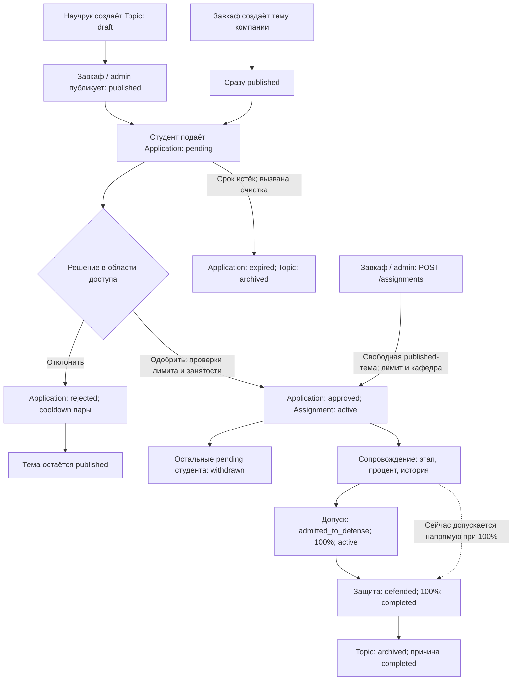
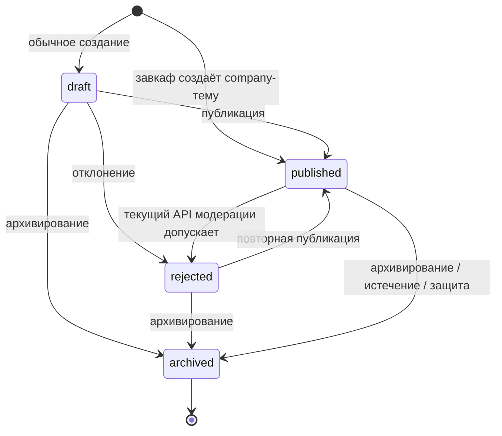
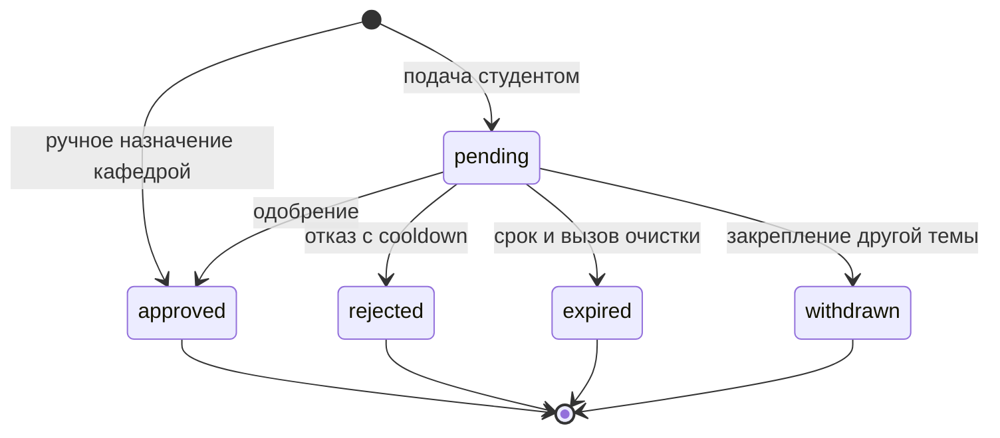
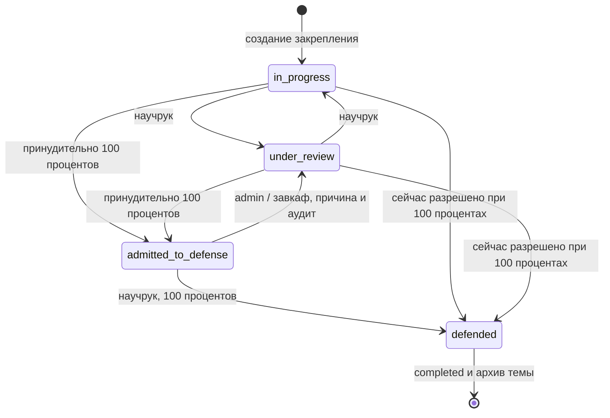

# Логика процесса и состояния

Снимок реализации `95ca12e`, проверка 18.11.2026.
Диаграммы описывают существующее поведение. Спорные правила отмечены отдельно;
их наличие в коде не означает согласование техлидом.

## Сквозной сценарий

Ручное назначение создаёт отдельные `Application(approved)` и `Assignment(active)`.
Закрытый период не блокирует это административное действие. Нельзя забрать тему
с чужой pending-заявкой, обойти лимит или второе активное закрепление студента.

## Тема

Возврат в `draft` и модерация уже архивной темы запрещены. Научрук отправляет
запрос на архивирование; завкаф/admin принимает решение. Этот путь запрещает
архивирование при активном закреплении. Прямой `PATCH /topics/{id}/status`
сейчас такую проверку не выполняет — см. R02 в [реестре решений](backend-review-appts.md).
Архивирование не является физическим удалением.

## Заявка

- До закрепления студент может иметь pending-заявки на разные темы.
- На одну тему допускается одна активная заявка (`pending` или `approved`).
- После закрепления остальные pending студента автоматически отзываются.
- Самостоятельного отзыва заявки студентом через API нет.
- Срок решения и cooldown после отказа используют одну настройку
  `APPLICATION_DECISION_TIMEOUT_MINUTES`. В шаблоне и fallback кода — 2 минуты;
  для демонстрации README рекомендует 20160 минут (14 дней).
- Истечение выполняется при отдельных запросах/командах, включая некоторые GET.
  Фонового расписания нет. Существующая функция архивирует тему и не создаёт
  уведомление об истечении. Старое предложение «вернуть тему в каталог и уведомить»
  не соответствует этому коду.

## Закрепление и прогресс

`Assignment.status` (`active`, `completed`, `cancelled`) и `current_stage` —
разные поля. Ниже показаны этапы; отмена закрепления ещё не имеет рабочего API.

Повторное обновление внутри одного незавершённого этапа допускается. Обычным
PATCH прогресса нельзя вернуть допущенную работу на предыдущий этап.
Отзыв допуска — отдельный `POST /assignments/{id}/revoke-admission`; сохраняет
100%, автора и причину, переводит в `under_review`. После `defended` обновление
прогресса и отзыв допуска запрещены.

Переход непосредственно к `defended` из первых этапов уже разрешён и проверяется
существующими тестами. Если допуск обязателен, это изменение контракта, а не
исправление изображения диаграммы. Согласование: R05 в [ревью](backend-review-appts.md).

## Неопределённые правила для согласования

1. Истёкшая заявка архивирует тему или освобождает её для других студентов?
2. Для подачи достаточно `status != closed` или необходимы `open` и интервал дат?
   Сейчас код блокирует только `closed`, не проверяя `draft`, `archived` и окно подачи.
3. Обязателен ли допуск перед защитой, кто фиксирует факт защиты и на каком основании?
4. Кто меняет тему/научрука и как сохраняются причина, история, прогресс и документы?
5. Какие связи блокируют смену кафедры у студента и у руководителя?
6. Какие события создают уведомления и кто должен их получать?

Приоритеты, наблюдаемые ответы API и критерии приёмки приведены в
[пакете для техлида](backend-review-appts.md).
